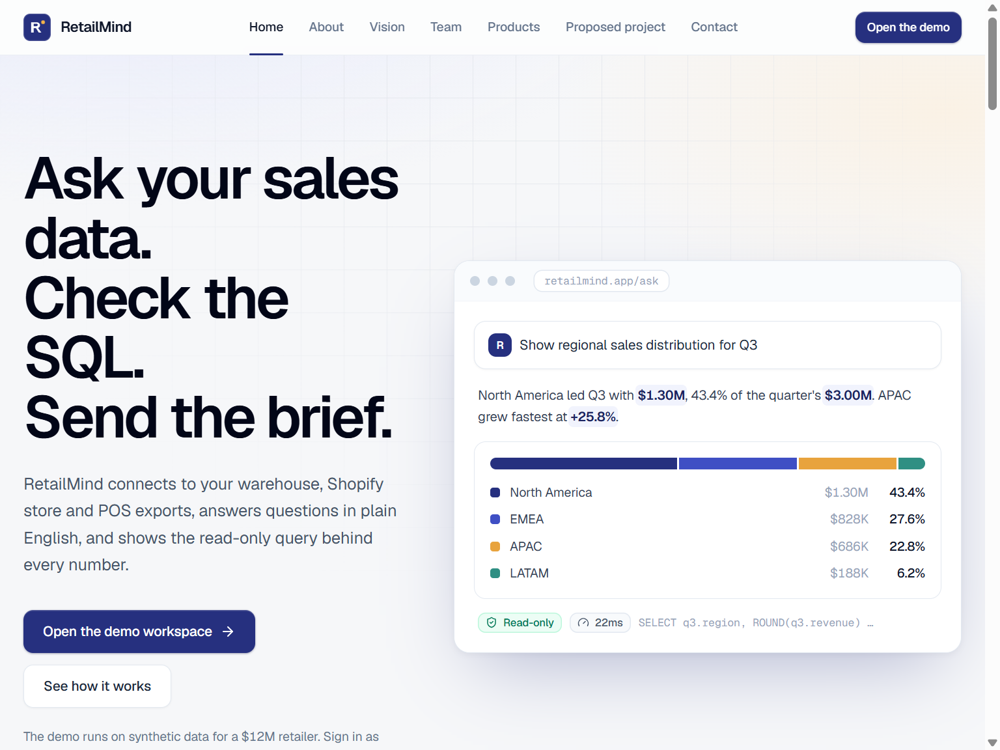
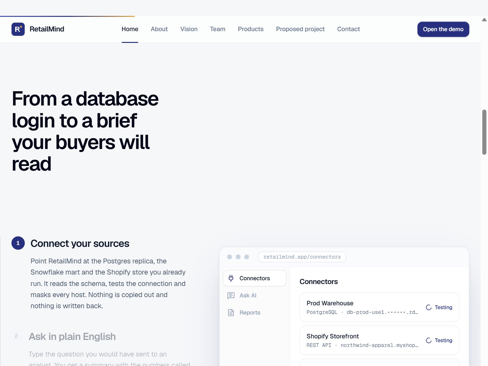

# RetailMind

**Retail decisions should not have to wait for a spreadsheet or an analyst.**

[Experience RetailMind on Vercel](https://retail-mind-eight.vercel.app/)

## The problem

Picture a shop owner getting ready for the weekly buying meeting. Sales are spread across the point-of-sale system, the online store, and a warehouse export. They want to know which products are losing margin, whether online sales are growing, and what needs to be reordered.

The numbers may be in the business already, but getting a useful answer can mean exporting files, reconciling columns, building a spreadsheet, or waiting for someone who knows SQL. By the time the answer arrives, the meeting may be over. And when a number appears without the query behind it, it is hard to know whether to trust it.

## A clearer way to ask

RetailMind is built around a simple idea: ask a business question in plain language, then inspect the SQL and results used to answer it. The experience brings together:

- A dashboard for revenue, margin, average order value, retention, product velocity, and stock alerts.
- Ask AI responses with a summary, chart, result table, and inspectable SQL.
- A connector walkthrough showing how retail data sources could be connected.

## Experience the live demo

Visit **[retail-mind-eight.vercel.app](https://retail-mind-eight.vercel.app/)** to explore the live website and interactive product walkthrough.

## Screenshots

### Ask a retail question and inspect its answer

### Follow the workflow from data sources to analysis

## Built with

React, TypeScript, Vite, Tailwind CSS, Recharts, and Framer Motion.
